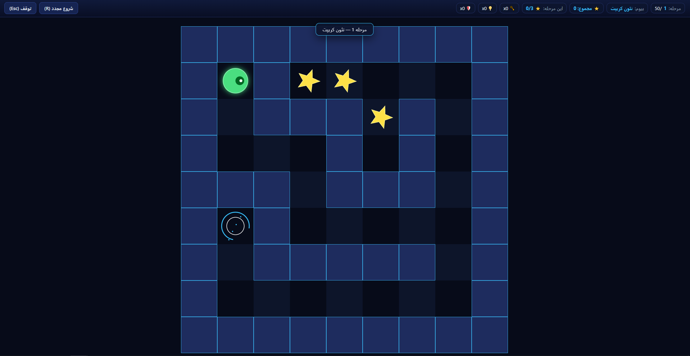

# 🌀 ماجراجویی در ماز | Maze Quest
<div align="center">


</div>
<div align="right">
یک بازی ماجراجویی معمایی مبتنی بر Canvas که در ۵۰ مرحلهٔ چالش‌برانگیز و در ۵ قلمرو منحصربه‌فرد طراحی شده است. بازی با مازهای قطعی (Deterministic)، سیستم جمع‌آوری ستاره، مه و تاریکی، خطرات محیطی و یک فروشگاه ارتقا و آیتم‌های مصرفی پیاده‌سازی شده و همه‌چیز در یک فایل مجزای HTML جای گرفته است.
</div>

## 🎮 بازی کردن

**[همین حالا بازی کنید: اجرای آنلاین و تجربه بازی](https://iammfk.github.io/maze-quest/)**

<br/>

فایل `index.html` را در هر مرورگری که JavaScript در آن فعال است باز کنید — با دوبار کلیک یا کشیدن فایل روی پنجره مرورگر اجرا می‌شود. نیازی به نصب، وب‌سرور یا تنظیمات اضافی نیست.

### 🖼️ پیش‌نمایش بازی

<p align="center">
  
</p>

## 🕹️ نحوهٔ بازی

1. کاراکتر خود را با کلیدهای جهت‌نما، WASD یا دکمه‌های لمسی صفحه در دالان‌های ماز هدایت کنید.
2. در هر مرحله تا سقف **۳ ستاره** در بن‌بست‌ها مخفی شده است؛ آن‌ها را جمع‌آوری کنید تا موجودی ستاره‌های شما افزایش یابد.
3. در صورت وجود موانع، کلیدهای رنگی را برای باز کردن درهای متناظر بردارید و خود را به درگاه خروج (پورتال نئونی) برسانید.
4. پس از اتمام هر مرحله، پنجرهٔ نتایج به شما امکان رفتن به مرحله بعد، شروع مجدد یا ورود به **فروشگاه** را می‌دهد.

### 🏰 قلمروها و مکانیک‌های بازی

بازی دارای **۵۰ مرحله** در **۵ قلمرو** (هر قلمرو ۱۰ مرحله) است:

| قلمرو | مراحل | محیط |
| :--- | :---: | :--- |
| **۱. سرداب نئونی (Neon Crypt)** | ۱ تا ۱۰ | تم نئونی کلاسیک |
| **۲. معبد کهن (Ancient Temple)** | ۱۱ تا ۲۰ | تم خاکی و شنی |
| **۳. محراب وارپ (Warp Sanctum)** | ۲۱ تا ۳۰ | تم ارغوانی کیهانی |
| **۴. هسته مذاب (Molten Core)** | ۳۱ تا ۴۰ | تم گدازه‌ای آتشین | 
| **۵. خلأ سایبری (Cyber Void)** | ۴۱ تا ۵۰ | تم ماتریکس دیجیتال |

> 🌑 **قانون تاریکی و پالس دید:** در مراحل ۱ تا ۷ هر قلمرو، کل نقشه کاملاً روشن و نمایان است. تاریکی عمیق و لزوم استفاده از «پالس دید» منحصراً در **۳ مرحله پایانی هر قلمرو (۸ تا ۱۰، ۱۸ تا ۲۰، ۲۸ تا ۳۰، ۳۸ تا ۴۰، ۴۸ تا ۵۰)** فعال می‌شود تا اوج هیجان قلمرو را رقم بزند.

---

### 🛒 فروشگاه و ارتقاها

ستاره‌های جمع‌آوری‌شده در سراسر مراحل در حافظه مرورگر (`localStorage`) ذخیره می‌شوند و می‌توانید در فروشگاه بین مراحل، از آن‌ها استفاده کنید:

* **کلید همه‌کاره (Master Key - ۸ ستاره):** کلید اضطراری که تنها در صورت نداشتن کلید عادی پشت در مصرف می‌شود (حداکثر ۳ عدد).
* **راهنمای نوری (Path Beacon - ۵ ستاره):** در ۳ ثانیهٔ ابتدایی مرحلهٔ بعد فعال شده، تاریکی را موقتاً محو و مسیر دقیق تا نقطه خروج را ترسیم می‌کند (حداکثر ۱ عدد).
* **سپر گدازه (Lava Aegis - ۶ ستاره):** از آسیب گدازه‌ها و خطرات محیطی جلوگیری کرده و ایمنی موقت ایجاد می‌کند (حداکثر ۲ عدد).
* **ارتقای پالس دید (سطح ۱: ۱۲ ستاره / سطح ۲: ۲۰ ستاره):** شعاع دید حاصل از پالس را در مراحل تاریک افزایش می‌دهد.
* **پوسته‌های ظاهری کاراکتر:** پوسته‌های طلایی، کریستالی، آتشین و سایبری.

---

### ⌨️ کنترل‌ها

| عمل | ورودی صفحه‌کلید | ورودی لمسی / ماوس |
| :--- | :--- | :--- |
| **حرکت** | کلیدهای `↑` `↓` `←` `→` یا `W` `A` `S` `D` | پد لمسی روی صفحه (D-Pad) |
| **پالس دید (در مراحل تاریک)** | کلید `Space` | دکمهٔ «پالس» روی صفحه |
| **توقف و منو** | کلید `Escape` یا `P` | دکمهٔ توقف در بالای صفحه |
| **شروع مجدد مرحله** | دکمه `R` | دکمه «شروع مجدد» |

---

## 💻 نیازمندی‌ها

- یک مرورگر وب استاندارد و مدرن با JavaScript فعال (Chrome، Firefox، Edge، Safari).
- بدون نیاز به سرور، اینترنت، پکیج یا نصب هیچ کتابخانهٔ جانبی.

## 🛠️ راه‌اندازی برای توسعه

کل پروژه در یک فایل واحد قرار دارد: HTML، استایل‌های درون‌خطی و کدهای جاوااسکریپت همگی در `index.html` مستقر هستند.

1. مخزن را کلون کنید یا فایل `index.html` را مستقیماً دریافت کنید:
```bash
   git clone https://github.com/IamMFK/maze.git
   
